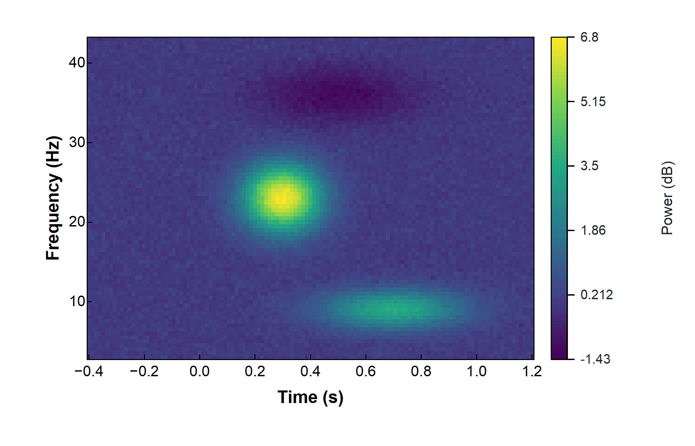
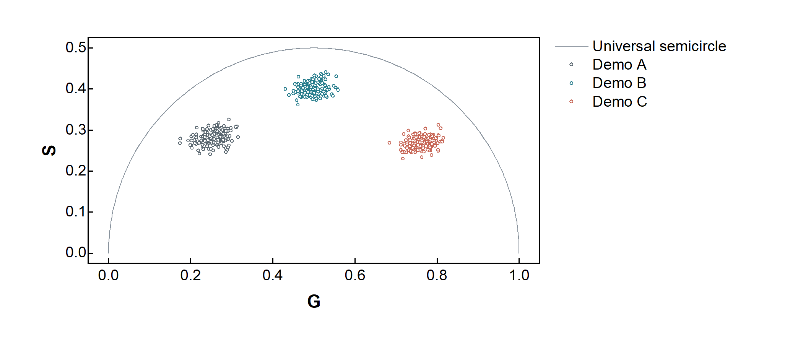

  
  <h1>EditaPlot</h1>
  
<strong>Understand the data, then build an editable Origin figure</strong>

  
Give Codex a table, confirm the meaning, and receive OPJU plus PNG / PDF / TIF.

  

    
    
    
    
  

  
<a href="#get-started">Get started</a> · <a href="docs/gallery.en.md">Explore templates</a> · <a href="docs/quickstart.en.md">Tutorial</a> · <a href="README.md">中文</a>

I built EditaPlot as a Codex Skill that explains column roles before choosing a chart and driving local Origin. You make the scientific decisions; the software turns the confirmed choices into a figure you can continue editing.

**For physical Windows 10/11 x64 computers with Codex and a local Origin/OriginPro installation.** macOS, Linux, WSL, and virtual machines are not supported. You do not need to open Origin manually first.

## See the results

<table>
  <tr>
    <td width="50%" align="center" valign="top">
       
      <strong>XPS observations and supplied components</strong> 
      Display available backgrounds, envelopes and components without inventing missing peaks.
    </td>
    <td width="50%" align="center" valign="top">
       
      <strong>Grouped boxes and raw observations</strong> 
      Show each observation alongside the group distribution.
    </td>
  </tr>
  <tr>
    <td width="50%" align="center" valign="top">
       
      <strong>Precomputed time–frequency matrices</strong> 
      Keep the complete grid, physical coordinates and units, with a detached scale.
    </td>
    <td width="50%" align="center" valign="top">
       
      <strong>FLIM G–S phasors</strong> 
      Display supplied coordinates without inferring lifetimes from raw images.
    </td>
  </tr>
</table>

All examples use **synthetic teaching data and real Origin output**. They are not experimental or clinical findings. Click an image for the full-resolution file.

**[Explore all 45 plotting routes →](docs/gallery.en.md)**　[中文图库](docs/gallery.md)

## Get started

### 1. Ask Codex to install the complete repository

You do not need to learn Git first. Copy this into Codex:

~~~text
Please install EditaPlot from the latest main branch:
Repository: https://github.com/hang-jin/editaplot
Keep the complete repository, including runtime, and run its root editaplot.cmd setup and doctor.
Reuse a compatible 64-bit Python 3.11/3.12 when available; ask before installing Python.
Do not install or modify Origin, change the registry/DCOM, request administrator rights, or use mouse control.
Report whether the environment is ready, then ask me for the dataset.
~~~

Alternatively, [download the complete ZIP](https://github.com/hang-jin/editaplot/archive/refs/heads/main.zip), extract it, and let Codex install from that folder. **Do not copy only <code>skill/editaplot</code>**: it needs the bundled drawing engine.

I use Git; show me the installation commands

~~~powershell
git clone https://github.com/hang-jin/editaplot.git
Set-Location editaplot
.\editaplot.cmd setup
~~~

If no compatible Python is available, follow the consent and setup steps in the [installation guide](docs/installation.md). Dependencies stay in the project environment, not global Python.

### 2. Attach a table and describe the intended comparison

Start a new Codex conversation, invoke <code>$editaplot</code>, and attach CSV, TXT, XLS, or XLSX data. For example:

~~~text
Use $editaplot to work with this dataset without modifying the original.
Explain each column's use, recommend 1–3 suitable charts, and list any units, uncertainty definitions or figure elements I need to confirm.
After I confirm, draw through Origin and deliver editable OPJU, PNG, PDF and TIF with axis, font and visual checks.
~~~

Chinese headers and file paths are supported. Ask for suggestions if you are unsure, or name a chart such as grouped boxes, XPS comparison, or precomputed SHAP.

Deidentify medical data and reference images under your institution's rules, including burned-in identifiers. EditaPlot does not promise automatic PHI detection.

### 3. Confirm the meaning and receive editable files

The checklist distinguishes **drawn columns, supporting columns, retained-but-hidden columns, and unresolved roles**. Missing measurements, components or uncertainty values are not fabricated.

By default, results stay together in a new folder beside the original dataset:

~~~text
my-data.csv
my-data_EditaPlot_<time>/
  render-plan.json
  result.opju
  result.png
  result.pdf
  result.tif
  …readback and verification reports
~~~

You may keep the editable Origin window open and adjust details such as the legend. Legend overlap may be adjusted later; missing axes, wrong fonts, overlapping color scales and clipped text still require correction. See the [full quick start](docs/quickstart.en.md).

How do I update an existing installation?

Ask Codex to inspect local changes, preserve your files, safely update the complete repository, and rerun <code>editaplot.cmd setup</code> and <code>doctor</code>.

The secure runtime uses Python 3.11/3.12 and Pillow 13, preferring 3.12 for new environments. Python 3.10 no longer carries this dependency lock. Replaced project environments and Skills are retained as backups; failed preparation never silently falls back to old dependencies. If an old plan reports <code>analysis_changed</code>, repeat understanding and confirmation and generate a new plan rather than editing its JSON.

## Choose by your data

I currently maintain **45 public plotting routes**. A route can accommodate different series counts, headers and supported display modes without becoming a separate template for every material. Inspect its input example before using your own data.

| Your data | Typical views | Input and examples |
|---|---|---|
| Materials, spectra and electrochemistry | XPS, XRD/GSAS, PL/TRPL, UV–Vis/Tauc, FTIR, NMR, DSC, XAS, EIS, CV, LSV | [XPS table](runtime/templates/xps/data_template.csv) · [XRD refinement](runtime/templates/xrd/example_gsas_publication.csv) |
| Grouped observations, uncertainty and composition | Bars, raw points, boxes, violins, rainclouds, stacked/percentage composition and forests | [Grouped boxes](runtime/templates/grouped_box/data_template.csv) · [Bars with uncertainty](runtime/templates/bar/data_template.csv) |
| Medical and model evaluation | ROC, PR, calibration, DCA, confusion matrices, Bland–Altman, paired trajectories and precomputed SHAP | [SHAP dashboard table](runtime/templates/shap_dashboard/data_template.csv) · [Gallery](docs/gallery.en.md) |
| Fluorescence, EEG and research signals | G–S phasors, common-amplitude traces, time–frequency matrices and event raster | [Data contracts and usage](docs/research_signals.md) |
| Relationships, flows and 3D | Scatter, bubbles, trends, radar, Sankey, directed networks and meaningful 3D curves | [Native examples and data](docs/gallery.en.md) |
| Categorical matrices | Heatmaps and density-adaptive matrices, retaining values and order | [Input format](runtime/templates/heatmap/data_template.csv) |

XPS, GSAS, SHAP, lifetime and bandgap workflows have specific scientific boundaries. The drawing layer does not silently fit, identify peaks, train models, reconstruct images or calculate spectra from raw EEG. Required upstream results and unresolved choices are stated first. Capabilities depend on the route and local checks.

## Reference figures and colors

Choose among **template defaults, reference-guided suggestions, and exact custom values**. Your explicit choices take precedence. A reference provides compatible grammar and style, not borrowed values, conclusions, sample names or watermarks.

For example: “Raw <code>#173F5F</code>, <code>2.4 pt</code> lines, <code>38%</code> fill transparency, an <code>18 × 18 cm</code> page, and no legend.” Codex checks the route and records each field as applied, template default retained, or rejected. Unsupported parameters are never presented as applied.

[Chinese palette selector](docs/palette-guide.md) · [Reference and exact-style policy](skill/editaplot/references/reference-figures.md)

## Environment and permissions

| Item | Current scope |
|---|---|
| OS | Physical Windows 10/11 x64; macOS, Linux, WSL, Wine/CrossOver, Parallels and other VMs are unsupported |
| Python | 64-bit CPython 3.11 / 3.12; 3.12 preferred, with automatic compatible-interpreter discovery |
| Origin | 2021–2026b is the compatibility target, not an assurance for every version/template combination |
| Live baseline | Python 3.12.14 + Pillow 13.0.0 + Origin 2024b (10.15.132), six representative regressions; other environments need smoke and template capability checks |
| Installation | Complete repository and project-local dependencies; Origin is not bundled, installed or modified |

**Grant only task-scoped access**: read the repository and selected data; write to the repository, the current user's <code>$HOME\.codex\skills\editaplot</code>, and the source data folder; run local commands and an EditaPlot-owned Origin instance. Network access is mainly for download, updates and locked dependencies.

Normal use needs no administrator rights, mouse control, whole-drive write access, or DCOM, registry, firewall or Origin-installation changes. For a protected output directory, permit only the current folder or explicitly select another writable destination.

What if Codex reports an isolated execution context or denied access?

Have Codex request formal, narrowly scoped local execution for **the original exact Origin command**. Rerun only after approval; auto-review neither guarantees approval nor grants all later commands. Do not move the task to administrator PowerShell, change DCOM/registry settings, or loop retries.

See [installation and troubleshooting](docs/installation.md) for the full procedure, queue behavior and timing diagnostics.

The local runtime and Origin automation do not initiate a network upload of your data. Files supplied to Codex remain governed by your Codex account, organization and retention policies. See [Privacy](PRIVACY.md).

## Go deeper

| What you want to do | Start here |
|---|---|
| Explore every chart and its input | [English gallery](docs/gallery.en.md) · [中文图库](docs/gallery.md) |
| Complete your first figure | [English quick start](docs/quickstart.en.md) · [中文教程](docs/quickstart.zh-CN.md) |
| Install, update or troubleshoot permissions and slow runs | [Installation guide](docs/installation.md) |
| Plot fluorescence and research signals | [Data and usage guide](docs/research_signals.md) |
| Check Origin-version boundaries | [2021–2026b compatibility](docs/origin-2021-2026-compatibility.md) |
| Understand source, dependencies and release scope | [Release boundaries](docs/release-boundaries.md) · [Dependency inventory](docs/dependency-inventory.md) |

## Star trend

If EditaPlot saved you time, a Star helps other researchers find it. I record only daily repository totals—**not account lists, IDs or personal star timestamps**.

  

## Open source, contributing, and support

I independently maintain EditaPlot under [Apache License 2.0](LICENSE). It is not affiliated with, sponsored by or endorsed by OriginLab Corporation; product names describe compatibility only.

Useful feedback includes a shareable minimal example and clear reproduction steps. Do not put medical records, private data, credentials or full private paths in Issues.

[Contributing](CONTRIBUTING.md) · [Support scope](SUPPORT.md) · [Security reports](SECURITY.md) · [Privacy](PRIVACY.md)

## Buy me a coffee ☕

If EditaPlot helped, you are welcome to buy me a coffee. Even a small tip encourages continued work on templates and tutorials.

Tips are entirely optional. They do not unlock features, change support priority or affect Apache-2.0 rights. Sharing the project or reporting a useful issue is just as welcome.

WeChat support QR

Please do not include experimental data, medical records or account details in a payment note.

