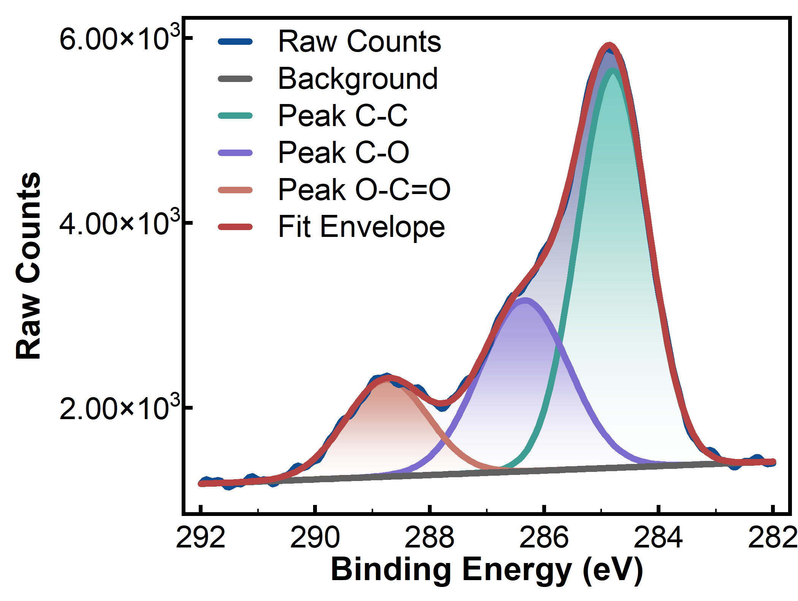
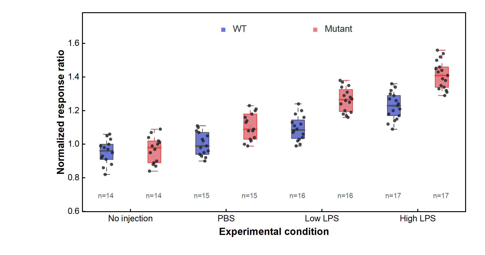
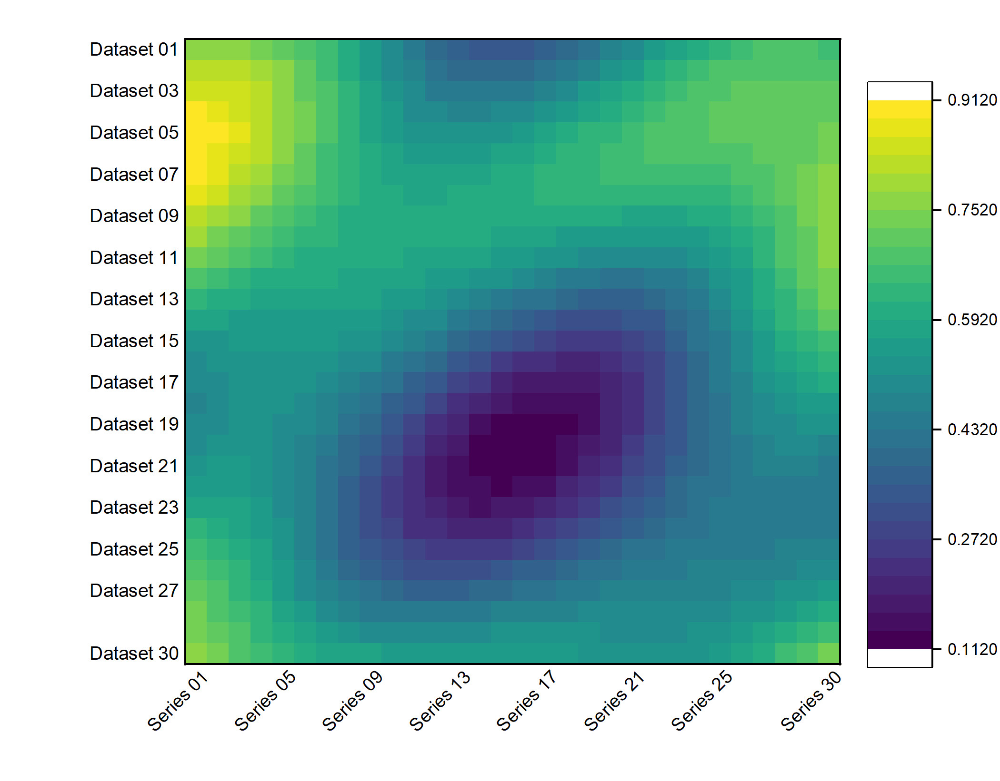

  
  <h1>EditaPlot</h1>
  
<strong>Give Codex the table. Get an editable scientific figure back in Origin.</strong>

  
Understand the data · Choose the view · Customize the style · Verify the deliverables

  

    
    
    
    
  

  
<a href="#get-started">Start</a> · <a href="docs/gallery.en.md">Gallery</a> · <a href="#three-common-requests-to-copy">Prompts</a> · <a href="docs/quickstart.en.md">Guide</a> · <a href="README.md">中文</a>

I built EditaPlot to spend less time repeatedly tuning figures and more time discussing the data itself.

Tell Codex what the table contains and what you want to show. It explains each column first, waits for confirmation, then uses local Origin and checks the result.

EditaPlot is a **Codex Skill, not a standalone plotting application**. You can continue editing curves, axes, and legends in Origin. Within each verified route, you can also specify supported colors, line widths, and layouts.

**Requirements: a physical Windows 10/11 x64 computer, Codex, and local Origin/OriginPro.** You do not need to open Origin first. macOS, Linux, WSL, and virtual machines are currently unsupported.

## See the results

<table>
  <tr>
    <td width="50%" align="center" valign="top">
       
      <strong>XPS observations and supplied components</strong> 
      Display available backgrounds, envelopes and components without inventing missing peaks.
    </td>
    <td width="50%" align="center" valign="top">
       
      <strong>Grouped boxes and raw observations</strong> 
      Show each observation alongside the group distribution.
    </td>
  </tr>
  <tr>
    <td width="50%" align="center" valign="top">
       
      <strong>SHAP importance, contribution, and beeswarm</strong> 
      Use upstream per-sample SHAP values; the plotting layer does not train a model.
    </td>
    <td width="50%" align="center" valign="top">
       
      <strong>30 × 30 dense heatmap</strong> 
      Keep all 900 source values and row/column order, without interpolation or automatic clustering.
    </td>
  </tr>
</table>

All examples use **synthetic teaching data and real Origin output**. They are not experimental or clinical findings. Click an image for the full-resolution file.

**[Explore all 45 plotting routes →](docs/gallery.en.md)**　[Fluorescence and EEG signals](docs/research_signals.md)　[中文图库](docs/gallery.md)

## Get started

### 1 / Install: give this request to Codex

You do not need to learn Git first. Copy this into Codex:

~~~text
Please install EditaPlot from the latest main branch:
Repository: https://github.com/hang-jin/editaplot
Keep the complete repository, including runtime, and run its root editaplot.cmd setup and doctor.
Reuse a compatible 64-bit Python 3.11/3.12 when available; ask before installing Python.
Do not install or modify Origin, change the registry/DCOM, request administrator rights, or use mouse control.
Report whether the environment is ready, then ask me for the dataset.
~~~

Alternatively, [download the complete ZIP](https://github.com/hang-jin/editaplot/archive/refs/heads/main.zip), extract it, and let Codex install from that folder.

**Do not copy only <code>skill/editaplot</code>**. It needs the bundled drawing engine.

I use Git; show me the installation commands

~~~powershell
git clone https://github.com/hang-jin/editaplot.git
Set-Location editaplot
.\editaplot.cmd setup
.\editaplot.cmd doctor
~~~

If no compatible Python is available, follow the consent and setup steps in the [installation guide](docs/installation.md). Dependencies stay in the project environment, not global Python.

### 2 / Provide the data: say what you want to compare

Start a new Codex conversation, invoke <code>$editaplot</code>, and attach CSV, TXT, XLS, or XLSX data. For example:

~~~text
Use $editaplot to inspect this dataset. Do not draw yet and do not modify the source file.
Explain each column in plain language, recommend no more than three suitable charts, and tell me what still needs confirmation.
~~~

Chinese headers and file paths are supported. Ask for suggestions if you are unsure, or name a chart such as grouped boxes, XPS comparison, or precomputed SHAP.

If the headers need reorganizing, open the [matching template example](docs/gallery.en.md) or ask Codex to compare your table with it.

Helper columns are created only in memory or the editable Origin workbook. The source file remains unchanged.

### 3 / Confirm and draw: receive files you can keep editing

After confirming groups, units, uncertainty meaning, and visible figure elements, continue with:

~~~text
Use the plan we just confirmed and draw it through Origin. Export an editable OPJU plus PNG, PDF, and TIF.
Check the data mapping, axes, fonts, and exported appearance, then briefly report the output location and verification result.
~~~

I have the Skill verify the local drawing path before rendering the formal dataset. It does not invent measurements, fitted components, or uncertainty values missing from the source.

By default, results stay together in a new folder beside the original dataset:

~~~text
my-data.csv
my-data_EditaPlot_<time>/
  render-plan.json
  result.opju
  result.png
  result.pdf
  result.tif
  …readback and verification reports
~~~

Add “keep the editable Origin window open” if you want to continue adjusting it.

**A picture alone is not completion.** A formal delivery also needs the real OPJU, other exports, and data and figure checks. See the [full guide](docs/quickstart.en.md).

How do I update an existing installation?

Ask Codex to inspect local changes, preserve your files, safely update the complete repository, and rerun <code>editaplot.cmd setup</code> and <code>doctor</code>.

The secure runtime uses Python 3.11/3.12 and Pillow 13, with 3.12 preferred for new environments. Python 3.10 no longer carries this dependency lock.

Replaced environments and Skills remain as backups. Failed preparation never silently falls back to old dependencies.

If an old plan reports <code>analysis_changed</code>, repeat the understanding and confirmation steps. Generate a new plan instead of editing its JSON.

## Three common requests to copy

### I am not sure what to plot

~~~text
Use $editaplot to inspect this table read-only. I want to compare differences among groups, but I have not chosen a chart.
Recommend no more than three options, explain the required columns, and wait for my confirmation before drawing.
~~~

### I already know the chart I want

~~~text
Use $editaplot to draw grouped boxplots with the raw observations overlaid.
First confirm the groups, Y-axis unit, meaning of each observation, and sample sizes. Do not add significance marks automatically.
~~~

### I want to follow a reference figure's style

~~~text
Use $editaplot to take color, line-width, and layout cues from this reference. Use only my table for data.
First list what the current template can adopt, what must keep its default, and what cannot be implemented. Wait for my confirmation before drawing.
Do not copy the reference's data, conclusions, sample names, or watermark.
~~~

## Choose by your data

I currently maintain **45 public plotting routes**. One route can accommodate different series counts, headers, and supported display modes.

You do not need a separate template for every material. Inspect the input example before using your own data.

| Your data | Typical views | Input and examples |
|---|---|---|
| Materials, spectra and electrochemistry | XPS, XRD/GSAS, PL/TRPL, UV–Vis/Tauc, FTIR, NMR, DSC, XAS, EIS, CV, LSV | [XPS table](runtime/templates/xps/data_template.csv) · [XRD refinement](runtime/templates/xrd/example_gsas_publication.csv) |
| Grouped observations, uncertainty and composition | Bars, raw points, boxes, violins, rainclouds, stacked/percentage composition and forests | [Grouped boxes](runtime/templates/grouped_box/data_template.csv) · [Bars with uncertainty](runtime/templates/bar/data_template.csv) |
| Medical and model evaluation | ROC, PR, calibration, DCA, confusion matrices, Bland–Altman, paired trajectories and precomputed SHAP | [SHAP dashboard table](runtime/templates/shap_dashboard/data_template.csv) · [Gallery](docs/gallery.en.md) |
| Fluorescence, EEG and research signals | G–S phasors, common-amplitude traces, time–frequency matrices and event raster | [Data contracts and usage](docs/research_signals.md) |
| Relationships, flows and 3D | Scatter, bubbles, trends, radar, Sankey, directed networks and meaningful 3D curves | [Native examples and data](docs/gallery.en.md) |
| Categorical matrices | Heatmaps and density-adaptive matrices, retaining values and order | [Input format](runtime/templates/heatmap/data_template.csv) |

XPS, GSAS, SHAP, lifetime, and bandgap workflows have specific scientific boundaries.

The drawing layer does not silently fit, identify peaks, train models, reconstruct images, or calculate spectra from raw EEG. Required upstream results and unresolved choices are stated first.

Capabilities depend on the route and local checks.

## Choose your reference style and colors

Choose among **template defaults, reference-guided suggestions, and exact custom values**. Your explicit choices take precedence.

A reference provides compatible grammar and style, not borrowed values, conclusions, sample names, or watermarks.

For XPS, for example: “Raw <code>#173F5F</code>, <code>2.4 pt</code> lines, <code>38%</code> fill transparency, an <code>18 × 18 cm</code> page, and no legend.”

Supported adjustments differ by template. Codex reports each request as applied, default retained, or rejected. It does not present an unsupported parameter as if it worked.

[Chinese palette selector](docs/palette-guide.md) · [Reference and exact-style policy](skill/editaplot/references/reference-figures.md)

## What you need to know before using it

| Item | Current scope |
|---|---|
| OS | Physical Windows 10/11 x64; macOS, Linux, WSL, Wine/CrossOver, Parallels and other VMs are unsupported |
| Python | 64-bit CPython 3.11 / 3.12; 3.12 preferred, with automatic compatible-interpreter discovery |
| Origin | 2021–2026b is the compatibility target, not an assurance for every version/template combination |
| Live baseline | Python 3.12.14 + Pillow 13.0.0 + Origin 2024b (10.15.132), six representative regressions; other environments need smoke and template capability checks |
| Installation | Complete repository and project-local dependencies; Origin is not bundled, installed or modified |

**Grant only task-scoped access.** Read the repository and selected data. Write only to the project, the current user's <code>$HOME\.codex\skills\editaplot</code>, and the data folder.

Allow local commands and a dedicated Origin instance. Network access is needed for downloads and dependency updates.

Normal use needs no administrator rights, mouse control, whole-drive write access, or DCOM, registry, firewall, or Origin-installation changes.

For a protected output directory, permit only the current folder or explicitly choose another writable destination.

What if Codex reports an isolated execution context or denied access?

Have Codex request formal, narrowly scoped local execution for **the original exact Origin command**. Rerun only after approval.

Auto-review neither guarantees approval nor grants all later commands. Do not use administrator PowerShell, change DCOM or registry settings, or loop retries.

See [installation and troubleshooting](docs/installation.md) for the full procedure, queue behavior and timing diagnostics.

**Deidentify sensitive data first**, including names or IDs left in reference images. I do not claim that the Skill finds every sensitive detail.

The local plotting runtime does not initiate a network upload. Files given to Codex remain governed by your account, organization, and retention policies. See [Privacy](PRIVACY.md).

Common questions: stalled runs, queues, and reference figures

- **Installation or drawing appears stuck:** check the last stage instead of submitting repeatedly.
- **How long should it take?** Once setup and confirmation are complete, 4–5 minutes is a reasonable local reference, not a deadline. If progress stops, use the [stage guide](docs/installation.md#runtime-duration).
- **Several tasks are open:** data analysis may run concurrently. Current EditaPlot releases queue the steps that actually call Origin within one Windows session. Do not treat a queue message as failure.
- **The result does not exactly copy a reference:** a reference is a visual brief, not a one-click cloning source. Supported styling can be adapted, while data meaning and verified rendering capabilities remain boundaries.
- **Reporting a problem:** share the Windows and Origin versions, the last short error, and a publishable minimal example. Do not publish full experiments, medical records, credentials, or private paths.

## Go deeper

| What you want to do | Start here |
|---|---|
| Explore every chart and its input | [English gallery](docs/gallery.en.md) · [中文图库](docs/gallery.md) |
| Complete your first figure | [English quick start](docs/quickstart.en.md) · [中文教程](docs/quickstart.zh-CN.md) |
| Install, update or troubleshoot permissions and slow runs | [Installation guide](docs/installation.md) |
| Plot fluorescence and research signals | [Data and usage guide](docs/research_signals.md) |
| Check Origin-version boundaries | [2021–2026b compatibility](docs/origin-2021-2026-compatibility.md) |
| Understand source, dependencies and release scope | [Release boundaries](docs/release-boundaries.md) · [Dependency inventory](docs/dependency-inventory.md) |

## Star trend

If EditaPlot saved you time, a Star helps other researchers find it. I record only daily repository totals—**not account lists, IDs or personal star timestamps**.

  

## Open source, contributing, and support

I independently maintain EditaPlot under [Apache License 2.0](LICENSE). It is not affiliated with, sponsored by or endorsed by OriginLab Corporation; product names describe compatibility only.

Useful feedback includes a shareable minimal example and clear reproduction steps. Do not put medical records, private data, credentials or full private paths in Issues.

[Contributing](CONTRIBUTING.md) · [Support scope](SUPPORT.md) · [Security reports](SECURITY.md) · [Privacy](PRIVACY.md)

## Buy me a coffee ☕

If EditaPlot helped, you are welcome to buy me a coffee. Even a small tip encourages continued work on templates and tutorials.

Tips are entirely optional. They do not unlock features, change support priority or affect Apache-2.0 rights. Sharing the project or reporting a useful issue is just as welcome.

WeChat support QR

Please do not include experimental data, medical records or account details in a payment note.

